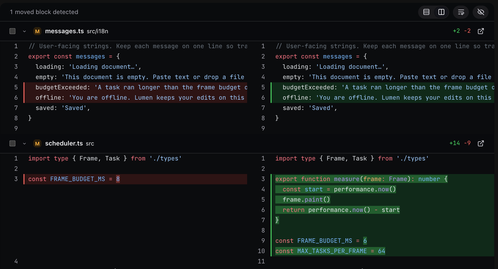
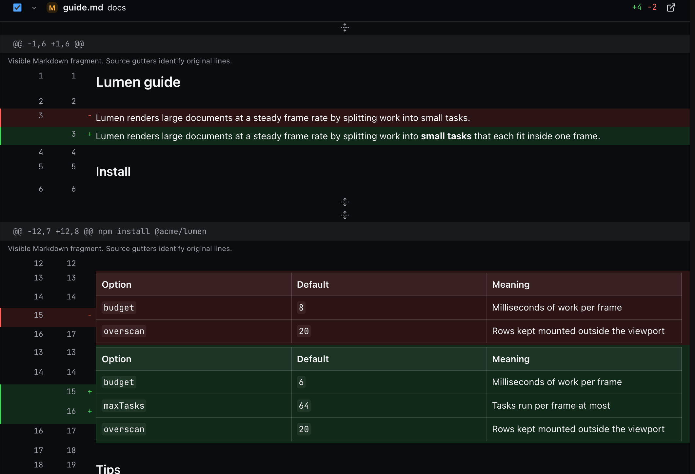
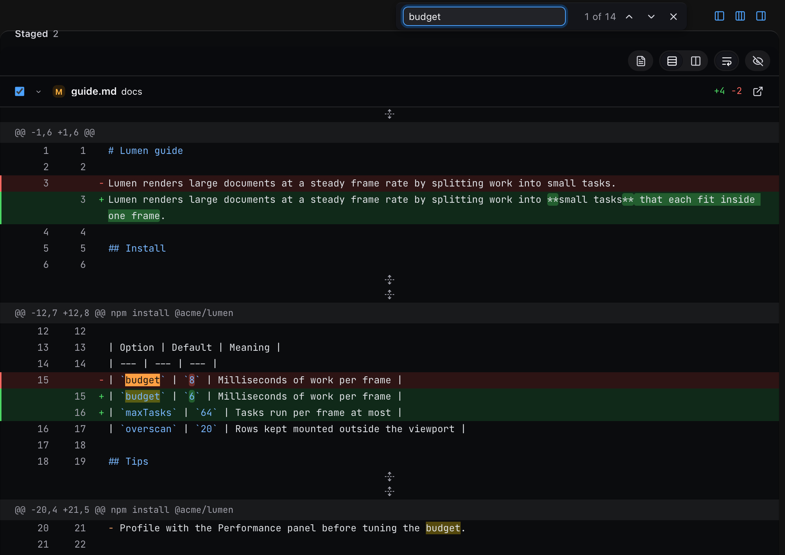
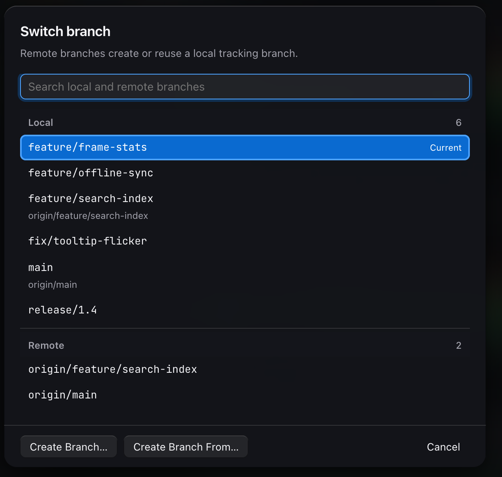

<div align="center">

<picture>
  <source media="(prefers-color-scheme: light)" srcset="docs/screenshots/overview-light.png">
  
</picture>

# BetterGit

**A fast, keyboard-friendly Git client for macOS, built for people who keep a lot of repositories open.**

Electron · React · TypeScript · Bun · macOS only

</div>

---

BetterGit puts every repository you work on in one sidebar and shows each one's changes as a single scrolling diff. You can review, edit, stage, and commit without opening another window. The layout borrows from Sublime Merge. The rest comes from wanting to fix a typo in the diff itself instead of switching to an editor for one line.

It runs the `git` CLI you already have, with your existing SSH keys and credential helpers. BetterGit stores no tokens.

> [!NOTE]
> BetterGit is a personal project in active development. It is unsigned, has no packaged release, and runs from source. Read [Quirks and limitations](#quirks-and-limitations) before you trust it with work you can't redo.

## Contents

- [Features](#features)
- [Keyboard shortcuts](#keyboard-shortcuts)
- [Get started](#get-started)
- [Project structure](#project-structure)
- [Performance](#performance)
- [Quirks and limitations](#quirks-and-limitations)
- [Contributing](#contributing)

## Features

### All your repositories in one sidebar

- Add a folder and BetterGit scans it for repositories. The sidebar shows the folder tree, skipping `node_modules`, dot-folders, and symlinks.
- Each repository shows its current branch, or a short hash when HEAD is detached, plus a count of uncommitted files.
- Hide repositories you rarely touch. The eye button shows them again, greyed out.
- Drop a folder onto the sidebar, or clone from a URL.
- Background fetch runs every few minutes while you're at the machine. It only fetches. It never pulls, pushes, or touches a repository without a remote.
- A file watcher refreshes the views when files change on disk.

### Changes as one stacked diff

The Changes tab lists staged, conflicted, and unstaged files as a flat list or a folder tree. Every file's diff stacks in one scrolling pane. Click a file in the list to jump to it.

- Stage and unstage per file with a checkbox, or everything at once.
- Discard unstaged changes to tracked files, after a confirmation.
- Write a message and commit with <kbd>⌘</kbd> <kbd>Enter</kbd>. Drafts survive switching repositories and tabs.
- Lock files and diffs over 400 changed lines start collapsed.
- Moved code gets detected. Read-only diffs connect each moved block to its new place with an arrow.

### Edit right in the diff


Unstaged files in the Changes tab are editable in place. Their rows already look like the editor, so nothing jumps when it opens.

- A plain click opens the editor with the caret where you clicked. Dragging still selects text.
- <kbd>Enter</kbd> on a focused file opens it from the keyboard.
- Keys you type before the editor is ready are kept, in order.
- Save with <kbd>⌘</kbd> <kbd>S</kbd>, or press <kbd>Esc</kbd> to throw the edit away. The diff updates as you type.

The editor refuses rather than guesses:

- It won't open symlinks, binary files, text that isn't valid UTF-8, or files over 1 MB.
- It won't save over a file that changed on disk after you started editing. Cancel and edit again.
- It keeps every path inside the repository, even through symlinks.

For anything bigger, the file header has an **Open in VS Code** button.

### Read diffs the way you want



The toolbar above each diff has:

- 3, 10, 25, or all lines of context. The buttons have no label. Hover one and the tooltip explains it. In Changes you can also widen one file at a time.
- Unified or split layout. Both keep the `+` and `-` markers.
- Word wrap, next to Hide whitespace. Turn wrap off and long lines scroll sideways. In split view both panes scroll together.
- Hide whitespace, which passes `--ignore-all-space` to Git so whitespace-only edits drop out.

Syntax highlighting comes from Shiki with GitHub's light and dark themes, and it runs in a Web Worker. If the worker can't start, it runs on the main thread instead. You can map file extensions to languages in Settings.

### Formatted Markdown diffs



Turn on **Format Markdown** and `.md` files render as formatted text: headings, emphasis, lists, code, and GitHub-flavoured tables. The gutters keep the original source line numbers, so you can still tell exactly which lines changed.

### Find in the diff



<kbd>⌘</kbd> <kbd>F</kbd> opens an in-app find bar. It searches the diff data, not just what's on screen.

- Every match gets a highlight, and the current match gets a stronger one.
- Matches count even in rows that haven't been drawn yet, in collapsed files, and in folded unchanged lines. Stepping to one opens its fold.
- A match on a removed line lands on that removed line.
- <kbd>Enter</kbd> and <kbd>⌘</kbd> <kbd>G</kbd> step forward, and <kbd>Shift</kbd> steps back.

### History and the commit graph


- A lane graph of every local and remote branch, 300 commits at a time. **Load more** fetches the next page, and stepping with the arrow keys loads it ahead of you.
- The commit list draws only the rows near the viewport, so a long history stays light. After five pages it holds about 1,400 DOM nodes instead of about 20,600.
- **Load more** lays out only the new page of the graph, continuing from the last one, so the list doesn't freeze. The arrow keys never wait on it.
- History opens on the newest commit.
- Search commit messages with <kbd>⌥</kbd> <kbd>⌘</kbd> <kbd>F</kbd>, and filter by one or more authors.
- Commit details with per-file stats, and the commit's diff with the same toolbar as Changes.
- Right-click a commit, or press <kbd>Shift</kbd> <kbd>F10</kbd>, for checkout, branch, tag, cherry-pick, revert, amend message, compare (with the remote, the merge base, or any ref), and copy actions. Cherry-pick and revert write a backup ref first.

### Branches, conflicts, and repository actions

<p align="center">
  
</p>

**Branch switcher.** Click the branch name in the title bar to search local and remote branches in separate sections. Picking a remote branch creates or reuses a local tracking branch. It never resets one. You can also create a branch from the current HEAD or from any branch you choose.

**Repository actions.** The toolbar has fetch, pull (merge or rebase), pull from a chosen remote and branch, push (it sets the upstream on the first push), stash, pop, reset to upstream, and Fetch All Repositories. Reset to upstream asks first and writes a backup ref.


**Conflict resolution.** Conflicted files open in a resolver with **Accept current**, **Accept incoming**, and **Accept both** on every conflict, plus undo. **Save resolution** writes the file but never stages it. A reset button rebuilds Git's original conflict markers if you want to start over. The resolver refuses files it can't handle safely, such as custom merge drivers or unusual marker formats.

Conflict files open quickly. BetterGit runs `git merge-file` for up to 8 conflicts at a time, which took a 100-conflict file from about 1.75 s to about 0.42 s. Large conflict files render in chunks, and <kbd>Tab</kbd> still reaches every conflict.

### Looks like a Mac app

- Frosted-glass panels, the system font, and bundled JetBrains Mono for code.
- Light, dark, or follow the system.
- Resizable panes. Each one hides with a button in the tab row, and narrow windows fold panes into slim strips that open on hover.
- Four text sizes, and support for Reduce Motion.

## Keyboard shortcuts

| Action | Shortcut |
| --- | --- |
| Find in the diff | <kbd>⌘</kbd> <kbd>F</kbd> |
| Next and previous match | <kbd>Enter</kbd> or <kbd>⌘</kbd> <kbd>G</kbd>, add <kbd>Shift</kbd> to go back |
| Search History | <kbd>⌥</kbd> <kbd>⌘</kbd> <kbd>F</kbd> |
| Changes tab, History tab | <kbd>⌘</kbd> <kbd>1</kbd>, <kbd>⌘</kbd> <kbd>2</kbd> |
| Commit | <kbd>⌘</kbd> <kbd>Enter</kbd> in the message box |
| Save or revert an edit in the diff | <kbd>⌘</kbd> <kbd>S</kbd>, <kbd>Esc</kbd> |
| Step through commits | <kbd>↑</kbd> <kbd>↓</kbd> |
| Commit actions menu | <kbd>Shift</kbd> <kbd>F10</kbd> |
| Refresh | <kbd>⌘</kbd> <kbd>R</kbd> |
| Fetch, pull, push | <kbd>⇧</kbd> <kbd>⌘</kbd> <kbd>F</kbd>, <kbd>⇧</kbd> <kbd>⌘</kbd> <kbd>L</kbd>, <kbd>⇧</kbd> <kbd>⌘</kbd> <kbd>P</kbd> |
| Stash changes | <kbd>⇧</kbd> <kbd>⌘</kbd> <kbd>H</kbd> |
| Toggle the sidebar | <kbd>⇧</kbd> <kbd>⌘</kbd> <kbd>S</kbd> |
| Add a folder, clone a repository | <kbd>⌘</kbd> <kbd>O</kbd>, <kbd>⇧</kbd> <kbd>⌘</kbd> <kbd>N</kbd> |
| Reveal in Finder | <kbd>⇧</kbd> <kbd>⌘</kbd> <kbd>R</kbd> |
| Settings | <kbd>⌘</kbd> <kbd>,</kbd> |

## Get started

### Requirements

- macOS. The window uses macOS vibrancy and an inset title bar.
- [Bun](https://bun.sh) 1.4 or later.
- `git` on your `PATH`.
- VS Code, if you want the **Open in VS Code** buttons.

### Run from source

```sh
git clone https://github.com/wrick17/bettergit.git
cd bettergit
bun install
bun run dev
```

`bun run dev` starts electron-vite in development mode. Renderer changes reload the window. Main-process and preload changes need a restart.

### Other scripts

| Command | What it does |
| --- | --- |
| `bun run build` | Builds the main process, preload, and renderer into `out/`. |
| `bun run start` | Runs the built app from `out/`. |
| `bun run test` | Runs the test suite with `bun test`. |
| `bun run typecheck` | Type-checks the project with `tsc --noEmit`. |
| `bun run sample` | Creates a sample workspace of throwaway repositories in `fixtures/sample-workspace`. |

To try BetterGit without pointing it at your own work, create the sample workspace and add that folder in the app:

```sh
bun run sample
# options: bun run sample [directory] [--bulk=N] [--large=N] [--force]
```

There is no packaged `.app` yet. Run it from source.

## Project structure

```text
src/
  main/        Electron main process: window, menus, config, file watching, background fetch
    git/       Git operations through the git CLI: status, diff, history, graph, conflicts
  preload/     The window.bettergit API, the only bridge between the page and the main process
  renderer/    React UI: sidebar, Changes, History, diff view, inline editor, find, conflict resolver
  shared/      Types and helpers used by both sides
scripts/       Sample workspace generator
test/          bun test suites
```

The renderer runs with context isolation and the sandbox on, and it never sees Node or `ipcRenderer`. Git runs as a subprocess with argument arrays, never shell strings. Interactive credential prompts are off. Config is a JSON file in the Electron user data folder, saved atomically. If the file is corrupt, BetterGit moves it aside and starts from defaults.

## Performance

The goal is for every click and scroll to land on the next frame, even on large diffs. Most of the work goes into doing less:

- Syntax highlighting runs in a Web Worker, in short slices. Files over 400,000 characters skip highlighting.
- Highlighted lines and loaded diffs are cached, so toggling whitespace, layout, or Markdown formatting reuses earlier work.
- Diffs render in chunks, and only the chunks near the viewport mount. Inline editors mount only when you click into a file.
- The History list draws only the rows near the viewport, and its graph layout continues from the previous page.
- Conflict files run `git merge-file` 8 conflicts at a time.
- Git output is capped at 64 MiB. Past that, the command fails instead of truncating the diff.

Final measurements, as medians with the glass blur on:

| Interaction | Before | After |
| --- | --- | --- |
| Select a file in a 5,000-line working-tree diff | 95 ms | 67 ms |
| Turn on Markdown formatting the first time | 178 ms | 51 ms |
| Switch to the unified layout | 211 ms | 46 ms |
| Toggle Hide whitespace | about 55 ms | 28 ms |
| Select a Markdown commit in History | 286 ms | 123 ms |
| Type `the` in find, with every match highlighted | new | 14 ms |
| Scroll a diff, 95th-percentile frame | new | 2.6 ms |

The biggest wins came earlier, on large test repositories:

| Interaction | Before | After |
| --- | --- | --- |
| Toggle Hide whitespace on a large diff | about 1.1 s | under 70 ms |
| Select a commit that adds 12,000 lines | 4.4 s | 150 to 190 ms |
| Switch repositories, 3,000-commit history | 3.3 s | 229 ms |
| Open a file with 100 conflicts | about 1.75 s | about 0.42 s |

These numbers come from a production build of the renderer in headless Chromium on one machine, using test repositories and the real main-process Git code. They are not measurements on a 120 Hz or 240 Hz display. BetterGit sets no Electron frame-rate cap, so the rate you get depends on Chromium and your display.

## Quirks and limitations

**Editing in the diff**

- Unsaved edits are lost without a warning if you quit or reload the window. Save with <kbd>⌘</kbd> <kbd>S</kbd> first.
- Find inside an open editor searches the Git diff, not the unsaved text you've typed.
- If an editable file finishes loading while it's on screen, its rows swap once to the folded editor look.
- Only unstaged files are editable. Staged, deleted, binary, and conflicted files stay read-only.
- Formatted Markdown is read-only. Switch to the raw view to edit.
- Editable files draw no moved-block arrows. Arrows appear only in read-only diffs, such as History.
- In editable files, removed lines show as an indented block with no line numbers.
- Saving writes one kind of line ending. A file with any CRLF line saves as all CRLF. Any other file saves as LF.
- A change that only adds or removes the final newline can show as a one-line diff.

**Markdown rendering**

- A hunk that starts in the middle of a structure, such as a table without its pipes, a code fence, or an indented list item, renders as raw text.
- A single-column table cut below its header stays raw.
- Formatted Markdown always wraps, whatever the word wrap setting.

**History**

- The author filter resets when you switch repositories.
- Graph lanes break while you filter by author or search, because the hidden commits leave gaps in the lanes.
- Search matches commit messages only, not authors, paths, or diff content.
- History shows commits reachable from local and remote branches. Commits reachable only from a detached HEAD don't appear.
- **Load more** is a button. The list doesn't load more on its own as you scroll.
- If the selected commit is scrolled out of view, the context-menu key opens the menu at the list's top-left corner.
- Selecting a 12,000-line commit still costs one layout of about 50 ms.

**General**

- macOS only. There is no signed build and no installer.
- **Open in VS Code** is the only external editor option.
- Panes fold into strips when the window gets narrow: the sidebar below 1600 px wide, the file or commit list below 1280 px, and the detail pane below 1040 px.
- The sidebar shows folders as they are on disk. You can't make custom groups yet.
- Some Git features exist in the backend with no UI yet: dropping a stash, worktrees, blame, and file history.
- The idle threshold for background fetch is in the config file but not in Settings.
- There is no LICENSE file yet.

## Contributing

Issues and pull requests are welcome at [wrick17/bettergit](https://github.com/wrick17/bettergit). Before you open a pull request, run:

```sh
bun run typecheck
bun run test
```

There is no license file yet, so the default copyright rules apply until one is added.
