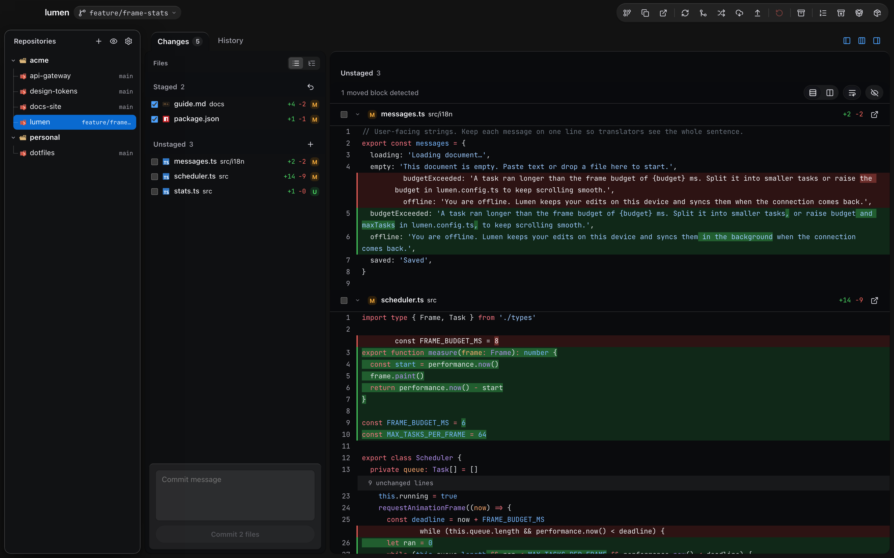
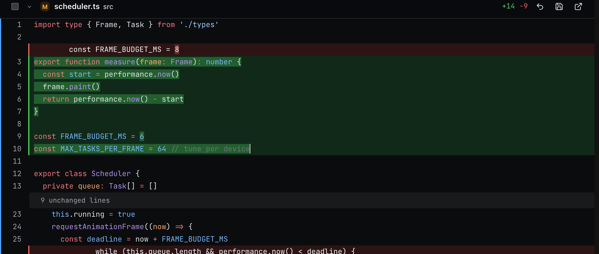
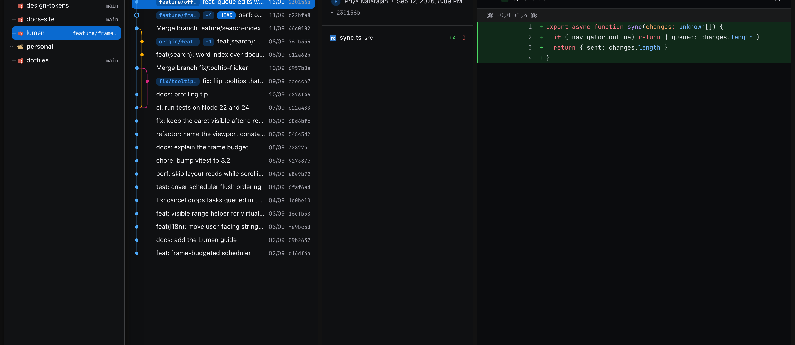
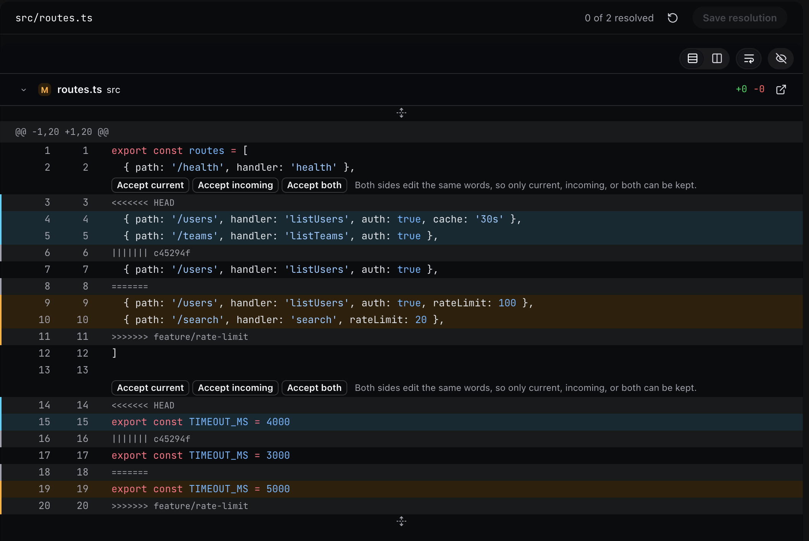

<div align="center">

<picture>
  <source media="(prefers-color-scheme: light)" srcset="docs/screenshots/overview-light.png">
  
</picture>

# BetterGit

**A fast, keyboard-friendly Git client for macOS, built for people who keep a lot of repositories open.**

Electron · React · TypeScript · Bun · macOS only

</div>

BetterGit runs the `git` CLI you already have, with your SSH keys and credential helpers. It stores no tokens.

> [!NOTE]
> Personal project in active development. Unsigned, no packaged release, runs from source.

## Features

- **One sidebar for every repository.** Add a folder and BetterGit scans it. Each repository shows its branch and uncommitted file count. Hide repositories, drop in folders, or clone from a URL.
- **Background fetch.** Fetches every few minutes while you're active. It never pulls or pushes.
- **Stacked diff.** Every changed file's diff in one scrolling pane, with per-file staging, discard, and commit.
- **Edit in the diff.** Click an unstaged file to edit it in place. <kbd>⌘</kbd> <kbd>S</kbd> saves, <kbd>Esc</kbd> discards.
- **Diff options.** Unified or split, 3 to all lines of context, word wrap, hide whitespace, moved-code detection, Shiki syntax highlighting.
- **Formatted Markdown diffs** that keep the source line numbers.
- **Find in the diff** across collapsed files and folded lines.
- **History graph** of all branches, with message search, author filter, and a commit menu: checkout, branch, tag, cherry-pick, revert, amend, compare.
- **Branch switcher** for local and remote branches.
- **Conflict resolver** with accept current, incoming, or both per conflict. It writes the file but never stages it.
- **Safe repository actions.** Fetch, pull, push, stash, and reset to upstream. Reset, cherry-pick, and revert write a backup ref first.
- **Mac look.** Glass panels, light and dark themes, resizable panes, Reduce Motion support.







## Keyboard shortcuts

| Action | Shortcut |
| --- | --- |
| Find in diff, next, previous | <kbd>⌘</kbd> <kbd>F</kbd>, <kbd>⌘</kbd> <kbd>G</kbd>, <kbd>⇧</kbd> <kbd>⌘</kbd> <kbd>G</kbd> |
| Search History | <kbd>⌥</kbd> <kbd>⌘</kbd> <kbd>F</kbd> |
| Changes, History | <kbd>⌘</kbd> <kbd>1</kbd>, <kbd>⌘</kbd> <kbd>2</kbd> |
| Commit | <kbd>⌘</kbd> <kbd>Enter</kbd> |
| Save, revert an edit | <kbd>⌘</kbd> <kbd>S</kbd>, <kbd>Esc</kbd> |
| Commit menu | <kbd>Shift</kbd> <kbd>F10</kbd> |
| Refresh | <kbd>⌘</kbd> <kbd>R</kbd> |
| Fetch, pull, push | <kbd>⇧</kbd> <kbd>⌘</kbd> <kbd>F</kbd>, <kbd>⇧</kbd> <kbd>⌘</kbd> <kbd>L</kbd>, <kbd>⇧</kbd> <kbd>⌘</kbd> <kbd>P</kbd> |
| Stash | <kbd>⇧</kbd> <kbd>⌘</kbd> <kbd>H</kbd> |
| Toggle sidebar | <kbd>⇧</kbd> <kbd>⌘</kbd> <kbd>S</kbd> |
| Add folder, clone | <kbd>⌘</kbd> <kbd>O</kbd>, <kbd>⇧</kbd> <kbd>⌘</kbd> <kbd>N</kbd> |
| Reveal in Finder | <kbd>⇧</kbd> <kbd>⌘</kbd> <kbd>R</kbd> |
| Settings | <kbd>⌘</kbd> <kbd>,</kbd> |

## Run from source

Requires macOS, [Bun](https://bun.sh) 1.4+, and `git` on your `PATH`. **Open in VS Code** needs VS Code.

```sh
git clone https://github.com/wrick17/bettergit.git
cd bettergit
bun install
bun run dev
```

| Command | What it does |
| --- | --- |
| `bun run build` | Build into `out/` |
| `bun run start` | Run the built app |
| `bun run test` | Run tests |
| `bun run typecheck` | Type-check |
| `bun run sample` | Create throwaway repositories in `fixtures/sample-workspace` |

## Limitations

- Unsaved edits in the diff are lost on quit or reload.
- Only unstaged files are editable. Formatted Markdown is read-only.
- History search matches commit messages only. **Load more** is manual.
- VS Code is the only external editor.
- No license file yet.

## Contributing

Issues and pull requests are welcome. Run `bun run typecheck` and `bun run test` before you open a pull request.
